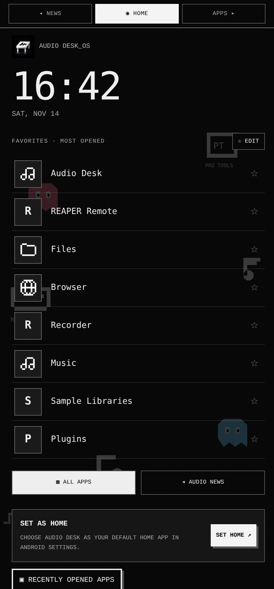
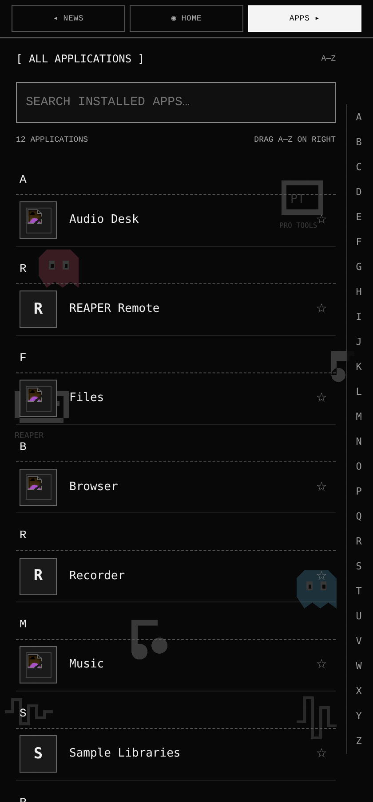
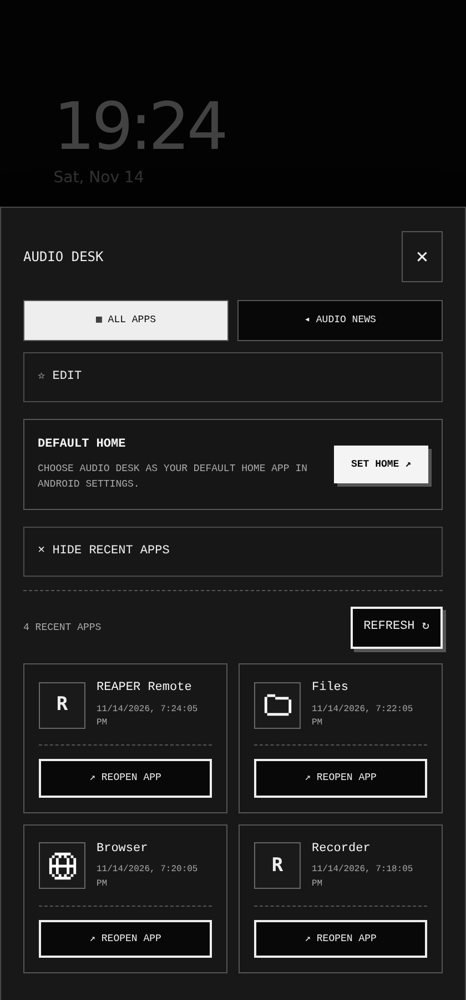
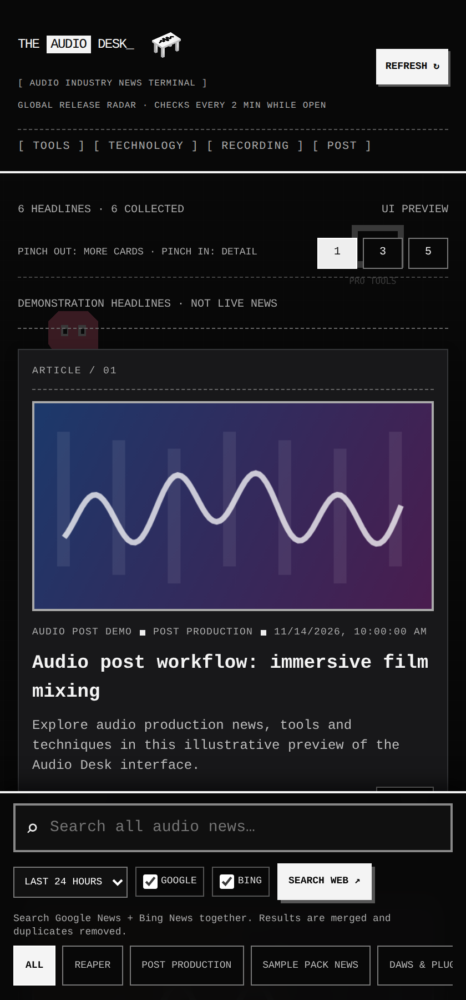
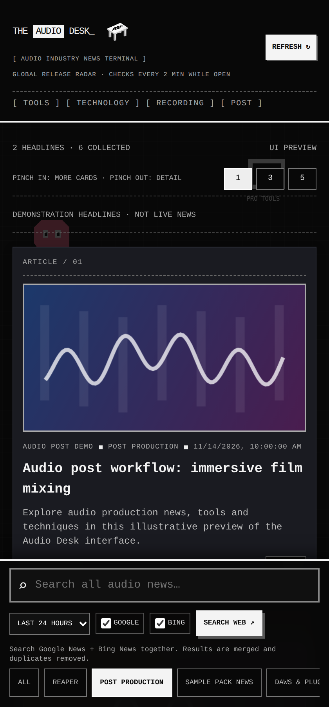
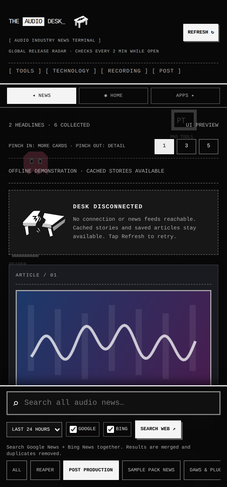
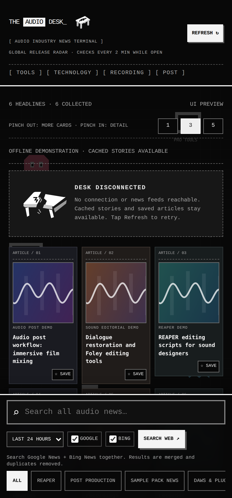
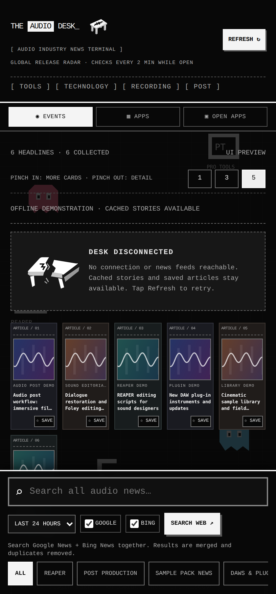
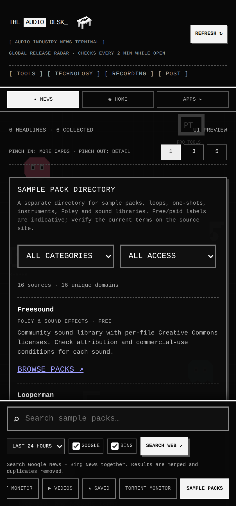

# Audio Desk Launcher

**A one-handed Android Home launcher for people who make sound, inspired by minimalist Niagara-style app access and Nokia N9 swipe navigation, without replacing Audio Desk's original retro design.** Follow what is happening in film and TV audio post, REAPER, sound design, DAWs and audio plug-ins, sample libraries, studio technology and more.

[**Download Audio Desk Launcher v2.1 APK**](https://github.com/balncmix-creator/audio-desk/releases/download/v2.1/Audio-Desk-Launcher-v2.1.apk) · [Browse releases](https://github.com/balncmix-creator/audio-desk/releases) · [Report an issue](https://github.com/balncmix-creator/audio-desk/issues)

> **Android test release:** The direct APK uses a stable **debug signing key**, not a private production key or Play Store signing. Install only if you trust this repository and its published builds.

## One-handed home launcher

The **default screen is now Home**, not the news feed. It keeps the original square-edged black-and-grey Audio Desk styling, pixel typography, and animated desk identity. The interface uses three horizontal spaces:

- **Swipe left-to-right → AUDIO NEWS:** all original Audio Desk stories, filters, REAPER and post-production headlines, bookmarks, sample previews, and pinch-grid options.
- **HOME (center):** a big clock and a single vertical list of your most-opened apps, with one-tap launching. Star any app from the alphabetized list to pin it at the top.
- **Swipe right-to-left → ALL APPS:** every app visible to Android's launcher, in an alphabetical vertical list with quick A–Z navigation along the right edge and search.

The list becomes personalized as you open apps from Audio Desk. **Usage counts are local to Audio Desk launches**, not Android's restricted global usage history. New installations initially show suggested apps until local launch counts develop. Favorite pins are stored locally.

The **Recently Opened** section is still accessible directly from Home. It shows apps opened through Audio Desk, not privileged Android running-task screenshots. The separate navigation strip is also available as a touch and accessibility fallback.

**To make Audio Desk your real Home:** install the APK, open Home and choose **SET HOME**, then select Audio Desk in Android's default Home chooser. The app cannot silently replace your previous launcher. You can revert via **Android Settings → Apps → Default apps → Home app**. Existing cached news and bookmarks remain in the same installed package.

## Screenshots

| Home · Most opened | A–Z app list |
|:--:|:--:|
|  |  |



*Screenshots are captured from the actual app's HTML/CSS using a browser test harness, with clearly illustrative installed-app icons and labels. The APK reads your device's actual apps, not these examples. Device system bars may differ.*


| Latest headlines | Post Production | Offline mode |
|:--:|:--:|:--:|
|  |  |  |

**Pinch-to-grid views:** three cards and five cards across. The screenshots use illustrative headlines.

 

**Sample pack audition screen:** 

*Genuine captures of the app's HTML interface at a phone-sized viewport, rendered in Chromium. The headlines and thumbnail artwork are **illustrative demo content**, not live news; Android system chrome and fonts may differ.*

## What can Audio Desk do?

- **Audio industry headlines:** Browse REAPER, **Post Production**, DAWs & plug-ins, plug-in releases, Sample Pack News, Sound Design, Hardware, Production and Videos.
- **Film/TV post-production radar:** Discover coverage of dialogue editorial, ADR, Foley, Atmos, immersive mixing, restoration, broadcast delivery and related tools in one unified category.
- **Subtle image color accents:** Dark grey article cards remain neutral without an image and receive a restrained color tint when an article has an image.
- **Offline reading:** Previously fetched and saved stories stay visible without a connection; the familiar desk becomes a broken-down offline illustration.
- **One-tap sample pack previews:** Automatically search the original announcement and matching product pages, then play a genuine audio demo when accessible.
- **Live release radar:** Incrementally checks worldwide sample-pack and plug-in news every two minutes while open, subject to publisher and indexing delays.
- **Customizable sources and bookmarks:** Add or remove RSS feeds and save stories for later.
- **Discovery tools:** Search news sources and explore relevant REAPER and audio-software developments.

## Install on Android

1. Open the [v2.1 launcher APK download](https://github.com/balncmix-creator/audio-desk/releases/download/v2.1/Audio-Desk-Launcher-v2.1.apk) on your Android phone. **This is an APK, not a ZIP.**
2. Open the downloaded file and, if Android asks, allow installations from the browser or file manager you used.
3. Launch **Audio Desk Launcher**. Tap **Applications → Set Home** if you want it to become your default Android launcher. Your existing Audio Desk bookmarks and cached feeds remain available.

Requires Android 6.0 (API 23) or later. The app currently targets Android 16 (API 36).

## Developing

The Android app is in `app/`; the WebView interface is `app/src/main/assets/index.html`. Automated browser tests cover news filters, bookmarks, cached/offline behavior, image accents and the Play review variant.

```bash
npm ci
npx playwright install chromium
npm test
node scripts/capture-readme-screenshots.cjs
```

The last command captures the app's interface into `docs/screenshots/` with labeled fictional example content. Tests and browser screenshots are not substitutes for physical-device testing.

## Changelog

### Version 2.1 — One-handed Audio Desk Home
- Home is now the startup screen, with your most-opened apps automatically ranked from locally recorded launches.
- Pin or unpin favorites using a star; suggested apps fill empty slots on fresh installations.
- Swipe **left** from Home for a vertical alphabetical app list with A–Z edge scrubber and app search; swipe **right** for the original Audio Desk news feed.
- Preserve the recent-launch drawer, app launch bridge, native Home selection, and existing audio-news experience.
- Retain the original monochrome pixel style and MeeGo-inspired depth/blur transitions. No Niagara trademarks or assets are reproduced.


### Version 2.0 — Audio Desk Launcher
- Register as an optional selectable Android HOME app, preserving the existing package and user data.
- Add real installed-app discovery, icons, search and launch actions through the native Android PackageManager, without broad package visibility or invasive permissions.
- Add MeeGo-inspired **Events / Applications / Open Apps** navigation and edge-swipe transitions with depth, blur and fade.
- Keep the original Audio Desk feed UI and its cards, image accents, pinch grids, bookmarks, RSS discovery and sample-pack demos.
- Track app launches locally for a practical recent-app reopening view. This is not the OS task switcher; live task snapshots and closing third-party tasks remain Android-controlled.


### Version 1.29
- Correct the pinch direction: **pinch inward** to zoom out into denser grids (1 → 3 → 5 cards per row), **spread fingers outward** to return to bigger cards (5 → 3 → 1).
- Update the layout hint and regression tests to match the gestures.
- Disable the main news WebView's competing native pinch-to-page zoom, while retaining the separate article browser's zoom behavior and the accessible 1 / 3 / 5 layout buttons.


### Version 1.28
- Two-finger pinch outward switches story cards from 1 to 3 across a row, then 5 across on another pinch; pinch inward reverses 5 → 3 → 1.
- Animate the tile rearrangement; compact thumbnails retain subtle image-derived accents and the default single-card layout remains unchanged.
- Tap a compact story to open a readable details sheet with the original article, Save and sample-pack demo controls.
- Apply density to recent sample-pack releases too, remember the choice after restart, and offer visible 1 / 3 / 5 buttons as an accessible alternative.
- Preserve vertical scrolling, one-finger horizontal tab swipes and pull-to-refresh.


### Version 1.27
- Replace the static/pulsing native pull-to-refresh desk icon with a genuine, continuously rotating 3D desk matching the 3D model in the app header.
- The tabletop, front/side faces, four legs and waveform turn together in orthographic space; pulling starts the rotation and it stops when refreshing finishes.
- Respect Android reduced-animation settings and avoid stretching or flattening the logo.


### Version 1.26
- Swipe horizontally across the story and resource content to switch between adjacent tabs, while keeping vertical scrolling and the horizontally scrollable bottom tab strip intact.
- During a swipe, the outgoing tab moves back in depth, gradually blurs and fades; a preview of the next tab slides up behind it before the real tab animates into place.
- Support swipes in both directions, cancel/edge resistance, reduced-motion accessibility and gesture exclusions for inputs, media controls and interactive buttons.
- Preserve the existing grey panels, subtle image accents, sample-pack preview player, and all news categories.


### Version 1.25
- One-tap sample-pack audition: the preview button searches matching web product pages if the source article lacks audio, checks publisher-hosted demos, and starts a directly playable stream automatically.
- Supports original SoundCloud and YouTube preview embeds when supplied; a platform may still block autoplay or require its own player controls.
- Two-minute incremental global release radar while the app is open, covering new sample packs, cinematic/game libraries, plug-in releases and independent developers; rotates Google News regions and deduplicates headlines.
- Shows a relevant verified product link or exact-title web search when a publisher does not expose an audio stream. Worldwide one-second completeness is not technically guaranteed.


### Version 1.24
- **Sample pack audition:** The Sample Packs directory now lists recent sample-pack news, with a per-pack **Find Demo** button. The Sample Pack News filter also offers audition controls.
- Plays real publisher-provided MP3/M4A/WAV/OGG previews directly inside the app using a tap-to-play HTML5 audio player; only one preview plays at a time.
- When RSS contains no demo, Android securely checks the publisher article's audio metadata, HTML5 audio tags, and SoundCloud/YouTube embeds. For external demos or unavailable direct media, users can open the original publisher/player.
- Preview links are cached locally; audio files are not downloaded or reproduced. Some publishers do not provide an embeddable demo.


### Version 1.23
- Add direct audio industry coverage from Rekkerd, A Sound Effect and Bedroom Producers Blog.
- Add targeted searches for Mix, postPerspective, Sonic State, Gearspace, Reapertips, Sample Library Review and VI-Control.
- Correct The REAPER Blog to the REAPER category, and remove the inactive Pro Audio Files news feed.
- Automatically scan ten curated publisher sites weekly for new RSS/Atom feed links (or on demand); native Android verifies same-publisher HTTPS feeds and RSS2JSON readability before adding them.
- Persist discovered sources, respect user-removed sources, and avoid duplicate entries. This expands coverage of monitored publishers but cannot find every unknown website across the internet.


### Version 1.21
- Merge the duplicate Post-production and POST PRODUCTION filters into **one** Post Production feed; normalize sources and migrate cached and saved article categories.
- Remove the repeated Production Expert RSS source.
- Add visitor-focused documentation and reproducible real-UI screenshots.

## Version 1.20

- Replace the Android launcher artwork in both legacy and adaptive icon slots with the approved polished Audio Desk artwork.
- Use the identical metallic desk image for native pull-to-refresh branding and as the in-app masthead fallback.
- Maintain the existing genuine 3D rotating desk for the active masthead, now with graduated metallic face shading.
- Package the shared image in both debug and Play review asset editions and test its presence.
- Preserve the offline illustration, sample categories and image-tinted article cards.

## Version 1.19

- Replace the flat SVG Y-axis flip in the masthead with a true three-dimensional rotating desk.
- Model a tabletop with thickness, multiple sides and four legs; keep a fixed orthographic rendering scale and a waveform on the tabletop.
- Rotate around the vertical axis only: no floating, stretching, shrinking or waveform-pulsing animation.
- Pause animation when the app is hidden and honor reduced-motion accessibility settings.

## Version 1.18

- Add the animated isometric Audio Desk icon beside the app title in the masthead.
- Use the same canonical tabletop, apron, sides, legs and projected waveform as the launcher icon.
- Animate slow rotation, gentle floating motion and waveform pulsing; disable animation when reduced-motion is requested.
- Keep the existing headline categories, grey/image-based accent cards, and offline broken-desk state.

## Version 1.17

- Route sample packs, sound libraries, construction kits and other sample products to a dedicated **Sample Pack News** filter, never to DAWs & plugins.
- Keep the existing sample-pack source directory separate from the news feed.
- Migrate locally cached and bookmarked article categories, even when offline.
- Exclude generic "release" and "update" words from DAW/plugin detection to avoid misleading classifications.
- Add browser regression tests for sample headlines, plugin articles, cached category migration, and saved news.

## Version 1.16

- Restore consistent physical thickness to the front edge of the isometric desk launcher and refresh logo.
- Show a broken-down rendition of the desk when offline or all news feeds cannot be reached; keep cached headlines visible.
- Keep neutral grey article cards and subtle image-derived accents (12% surface, 22% border).

## Version 1.15

- Keep neutral grey cards by default; image cards receive a subtle sampled colour tint.
- Sample publisher images natively when browser canvas access is restricted.
- Keep monochrome, missing and unreadable images neutral, without hiding valid thumbnails.

## Version 1.14

- Use the isometric desk and correctly projected waveform as the launcher icon.
- Reveal the same desk during pull-to-refresh; only the waveform oscillates.
- Stop motion after refresh, on timeout, while hidden, or when animations are disabled.
- Share canonical logo geometry between launcher, native loader and preview.
- Cover pull thresholds, cancellation, scroll and horizontal gestures with Android unit tests.

## Version 1.13

- Replace teal article cards and image-derived tints with subtle grey panels.

## Version 1.12

- Keep cached headlines when feed requests fail or the device is offline.
- Store saved article details independently of the rolling headline cache.
- Remember removed sources across restarts; adding the same URL restores it.
- Wire the release radar refresh and date controls, display watchlist scan results,
  and limit radar/watchlist requests to nine seconds.

## Regression checks

Run `npm install`, `npx playwright install chromium`, then `npm test`.
To use an existing Chromium installation, set `PLAYWRIGHT_CHROMIUM_EXECUTABLE_PATH`.
The checks run both editions at a phone-sized viewport with mocked feed responses,
including network failures. They do not replace Android device testing.

## APK builds and signing

GitHub Actions builds an installable debug APK and an unsigned Play review bundle
on pushes to `main`. Download the `Audio-Desk-APK` artifact from the successful
build. Version 1.26 uses version code 27 and targets Android 16 / API 36.

Release builds generate a separate asset bundle with torrent/warez discovery UI,
feed definitions and code removed. The ordinary debug APK retains its existing
feature set. `npm run prepare:play` regenerates the store page; do not edit it.

The existing debug certificate is retained so this update can install over older
Audio Desk builds. Its key is public and must not be used for trusted production
distribution. A production signing key must be generated privately and stored
outside this repository. Switching certificates for existing installations requires
a planned migration; simply deleting the public key does not revoke it.

See [Play Store preparation](play-store/README.md) for private signing and the
remaining developer-account requirements. No Play upload is performed by CI.
